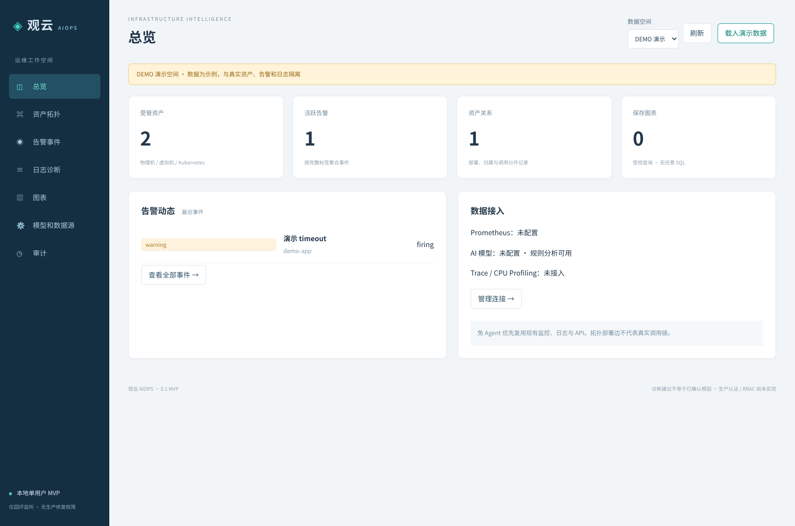
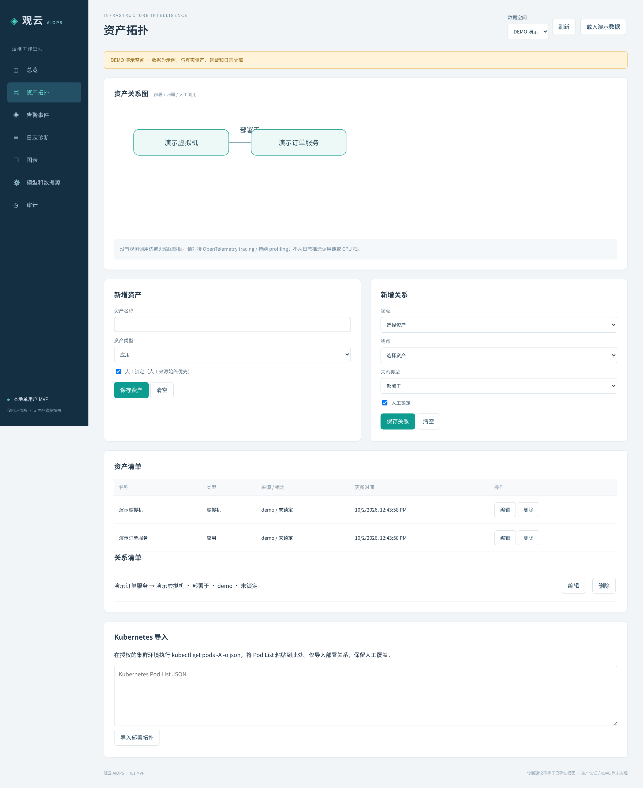
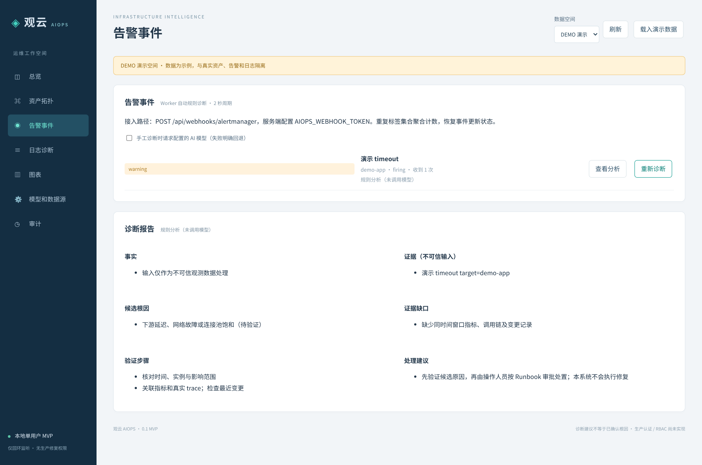
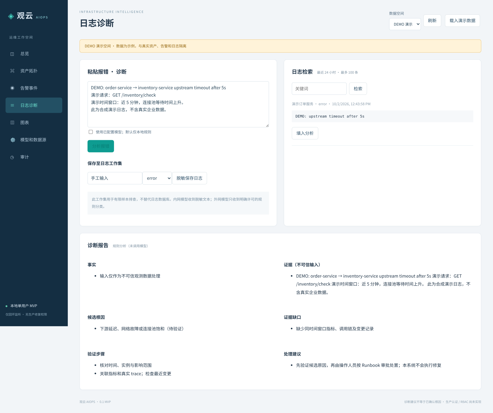
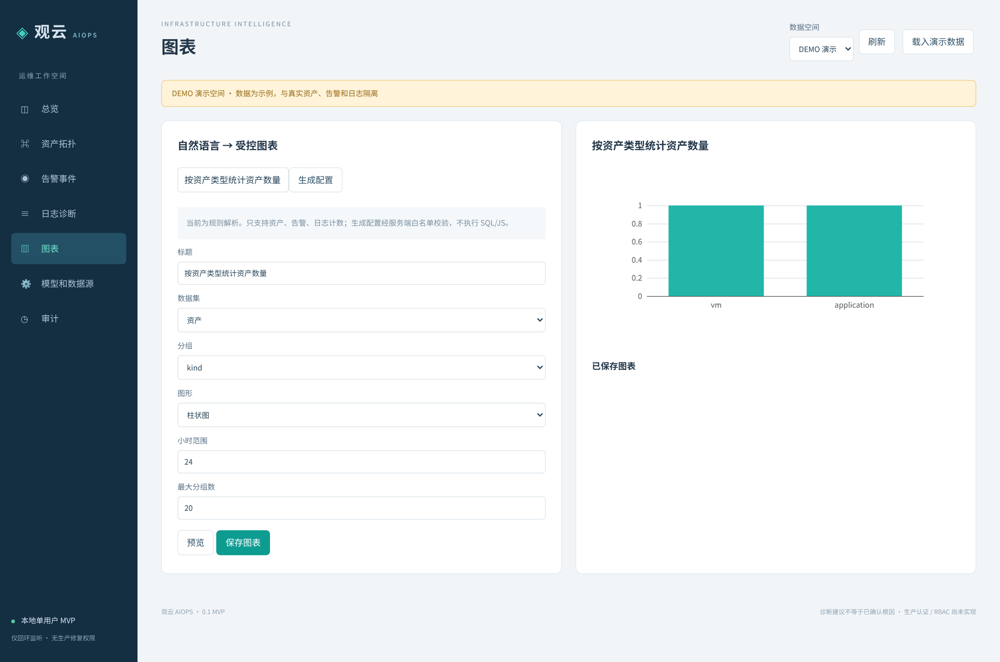

# aiopsctl

面向企业内部基础设施的 AIOps 项目，计划采用 .NET 10 与 Vue 3，覆盖物理机、虚拟机和 Kubernetes 环境。

## 计划方向

- 优先采用无代理（agentless-first）的接入方式，逐步完善基础设施信息采集与管理。
- 结合告警与日志证据辅助故障诊断，保留分析依据，供运维人员核查。
- 提供基础设施拓扑与指标图表，辅助理解资源关系和运行状态。
- 支持内部与外部模型的路由选择，按场景组织 AI 辅助分析。

## 当前状态

项目处于初始化阶段，功能实现正在推进。本仓库当前仅包含项目说明，上述内容均为规划方向，并非已实现功能。

尚不具备生产可用性，请勿直接用于生产环境。

---

## 云端 MVP（本次实现）

上方保留项目初始化时的规划。当前已实现可运行的 **.NET 10 API + 后台 Worker + Vue 3/TypeScript** 工作台，使用 SQLite 持久化；尚不具备生产可用性。

项目路径：`/workspace/aiopsctl`。基于初始化提交 `a15c929` 的 `mvp` 分支开发，未公开部署。真实和 DEMO 数据分区隔离，首次启动真实空间为空。

### 启动

需要 .NET SDK `10.0.401`（或 global.json 允许的同补丁系列）、Node 22.12+、npm、Python 3（集成测试）。云端实际使用 Node `24.19.0`。

```bash
cd /workspace/aiopsctl
source scripts/env.sh  # 仅此云端环境：设置 SDK、可写 NuGet 缓存
./scripts/run.sh
```

API 与编译后的前端同源服务于 **http://127.0.0.1:5080**。这是云端机器的回环地址，不是用户电脑地址；未发布公网预览。如需查看，应使用平台提供的受控端口访问方式，不能将监听改成 `0.0.0.0` 代替认证。

首次运行会从官方 npm/NuGet 源安装锁定依赖、构建前端和后端。数据库默认位于后端工作目录 `data/aiops.db`。可使用服务端 `AIOPS_DB` 指向持久卷上的绝对路径。停止用 Ctrl+C；用同一 DB 路径重启即可保留数据。

前端独立开发：启动后端后，在 `frontend` 执行 `npm ci --ignore-scripts && npm run dev`；Vite 仅监听回环地址，代理 API。常规验收推荐 `run.sh` 的同源模式。

### 可使用的功能

- 总览：资产、活跃告警、关系和保存图表；真实空状态。
- 资产拓扑：物理机/VM/Kubernetes/应用/中间件/数据库 CRUD；关系 CRUD、来源、更新时间、人工锁定；删除被引用资产会拒绝。SVG 拓扑区分部署、归属与人工记录调用。
- Kubernetes 导入：粘贴实际 `kubectl get pods -A -o json` 的 List（Pod 须已调度），建立 Pod/Node 和部署关系。自动导入不覆盖人工来源或锁定资产/关系。不会把 Node 猜成物理机，也不会伪造调用边。
- 告警：真实 Alertmanager webhook；按完整排序标签集合计算 fingerprint，重复计数、firing/resolved 状态更新；Worker 每 2 秒对未诊断事件产生结构化规则报告。
- 日志：多系统名称的有限日志样本保存、关键词/时间查询、粘贴报错分析。不是全量日志采集平台或日志数据库。
- 诊断：事实、证据、候选原因、缺口、验证步骤、处理建议；规则模式明确标注。模型未配置/不可用/未获外发许可时明确回退，不虚报调用成功。
- 图表：规则解析中文需求 → 可编辑、可校验的 schema → ECharts 柱/饼图 → SQLite 保存。仅白名单字段和计数，无 SQL、JS 或自由 PromQL。
- 设置和审计：服务端批准的端点配置；密钥不进入前端、配置读响应或审计。审计记录变更的对象 ID，不记录原文。

### 模型与数据源配置

详见 [配置说明](docs/CONFIGURATION.md)。只通过服务端部署环境注入密钥，不要在聊天中发送密钥。

- `AIOPS_ALLOWED_ORIGINS`：分号分隔精确 `scheme://IPv4:port` 许可表，默认空；私网也必须显式批准。只接受 IPv4 字面量，避免 DNS 重绑定；拒绝元数据地址、URL 凭据、重定向、非 HTTP(S)。无通配符。
- `AIOPS_MODEL_KEY`：OpenAI 兼容服务的 Bearer 密钥，仅服务端读取。
- `AIOPS_WEBHOOK_TOKEN`：Alertmanager webhook 的 Bearer 密钥，未配置时 webhook 拒绝访问。
- `AIOPS_DB`：SQLite 文件；`AIOPS_PORT`：回环端口（默认 5080）。

模型和数据源页面保存端点后不等于接入成功。Prometheus 按钮可发起真实只读 `up` 查询；无端点显示未配置。外网模型必须勾选明确允许 `ruleCategory`，仅发送 `timeout/unknown` 固定规则分类，不发送日志、资产或证据。内网模型使用脱敏文本；MVP 脱敏规则不能覆盖所有业务敏感信息，粘贴前仍应去除无关秘密。

### 验证

```bash
source scripts/env.sh
dotnet build backend/AiOps.Api
dotnet test backend/AiOps.Tests
python3 tests/integration.py
cd frontend
npm ci --ignore-scripts
npm run typecheck
npm run build
npm test
# 先在另一个终端启动后端；UI 测试会向该本地实例写入测试数据
npm run test:ui
```

集成测试启动独立后端和本地协议 fixture，使用临时数据库并真正重启进程。UI 测试使用已安装的 `/usr/bin/chromium`（可用 `CHROMIUM_PATH` 覆盖）。不要针对企业生产实例运行测试。详见 [验收结果](docs/TEST-RESULTS.md)。

### 范围与下一阶段

- **当前边界**：本地单用户，强制回环监听；尚无企业认证/RBAC/租户隔离，不对外暴露服务。相同 OS 用户本就可访问本地文件和服务，不能将数据空间当作安全租户。
- **尚未实现**：企业日志系统持续采集/检索适配器、自动应用/数据库调用发现、真实 trace/CPU flamegraph、SSO/RBAC、通知升级/值班/静默、SLO、变更时间线、Runbook 审批和生产存储迁移执行。
- **不提供**：自动 Shell、任意 SQL、生产修复工具；模型没有执行权限。自然语言图表当前是受控规则解析，不宣称通用 AI BI。
- **扩展路线**：[架构与阶段](docs/ARCHITECTURE.md)，明确接入已有观测系统，避免重写时序/日志数据库。


## 实际运行截图

以下截图于 2026-10-02 在云端运行本项目后，由 Chromium 实际渲染截取，均使用 **DEMO 演示空间**，不含企业真实数据。页面保留 DEMO 标识；告警与日志报告展示的是规则分析（未调用模型），并非设计稿或生成图片。点击图片可查看原图。

### 总览（DEMO）

[](docs/screenshots/demo-overview.png)

### 资产拓扑（DEMO）

[](docs/screenshots/demo-topology.png)

### 告警事件与诊断（DEMO）

[](docs/screenshots/demo-alert-diagnosis.png)

### 日志分析（DEMO）

[](docs/screenshots/demo-log-analysis.png)

### 图表（DEMO）

[](docs/screenshots/demo-charts.png)
