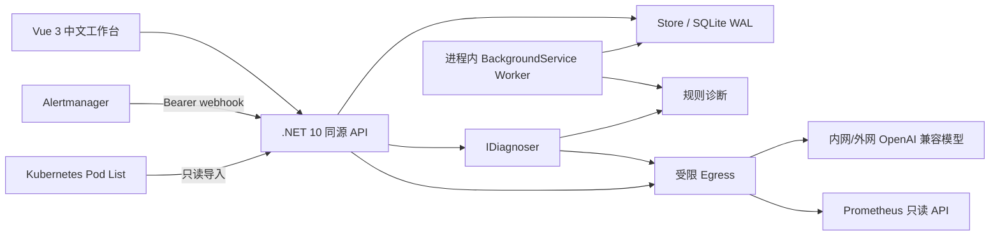

# 架构与阶段

## MVP 的实际结构

模块边界为 Domain（实体/规则/schema）、Store（持久化）、Egress（所有出站安全控制）、IDiagnoser/Diagnoser（模型抽象）、IncidentWorker（后台诊断）、Program（HTTP 编排）。MVP 在一个 .NET 进程中托管 API 与 Worker，避免一开始引入队列/多个服务。以后可将 Worker 拆为独立宿主，但当前 Store 锁是进程内锁，拆分前必须引入数据库并发控制/队列。

前端 Vue 3 + TypeScript；ECharts 仅注册 bar/pie、Grid、Tooltip、Canvas；拓扑用 SVG，避免第一版再增加 G6 依赖。所有用户/模型文本由 Vue 插值渲染，ECharts tooltip 用 richText，不接收自定义 formatter JS。后端部署静态产物，前后端同源。

数据空间键 real/demo 参与所有 CRUD；webhook 固定只写 real，demo seed 固定只写 demo。不是多租户授权机制。规则/模型输出分离，事实指输入可确认的陈述，证据标注不可信，候选根因永远待验证。

## 持久化和生产迁移

SQLite WAL 存储 documents(space,kind,id,body)，主键三列，参数化查询。单次对象变更和审计同事务；导入/一批 webhook 在进程锁中串行，但整批并非单个事务。首次创建 schema user_version=1，无破坏性自动迁移。重启持久化经进程级集成测试验证。

这是一种小规模控制面工作集实现，不是新的时序/日志数据库。生产路线：

1. 建立版本化关系模式和迁移工具，将 Asset、Relation、Incident、Chart、Settings、Audit 各自独立表，并加入 row version、外键、索引、分页及保留策略。
2. PostgreSQL 作为生产控制面存储（或组织标准关系数据库）；用双环境迁移演练，导出 real/demo 数据并核验数量/关系/审计，暂停写入后切换，保留回滚快照。
3. 日志留在 Loki/Elasticsearch/OpenSearch，指标留在 Prometheus/VictoriaMetrics；只保存连接信息、查询模板与必要诊断引用。先定义 ILogQueryAdapter，再接现有系统，限制查询和返回量。
4. trace 通过 Tempo/Jaeger 或现有 APM adapter，profiling 通过 Pyroscope/Parca；只有实际 span/profiling stack 才能绘制调用边/火焰图。现在显示未接入，不造图。

## 分阶段实施

- **阶段 1（已完成的 MVP）**：本地单用户端到端功能，资产关系、有限日志样本、告警聚合/规则诊断、模型辅助、受控图表，Prometheus/Alertmanager/Kubernetes 接入路径和安全回归测试。
- **阶段 2（未完成）**：SSO/RBAC/租户授权、TLS、密钥管理、审计防篡改；持久队列、幂等、保留与容量限制；多集群发现、现有日志平台适配、资产生命周期。
- **阶段 3（未完成）**：真实 traces/profiling 关联，应用/中间件/数据库自动关系发现，跨信号时间线和全链路候选根因排序；通知升级、值班、告警静默与依赖抑制。
- **阶段 4（设计边界）**：SLO/错误预算 adapter，ChangeEvent 时间线，Runbook 版本/审批模型。修复动作仍需独立、最小授权的执行服务和人工审批，模型不能直接获得 shell/SQL。

## 参考与许可

核对日期：2026-10-02。

- [ccfos/nightingale](https://github.com/ccfos/nightingale)：Apache-2.0，借鉴“接入已有观测存储 + 告警处理”产品边界，不替换 .NET 主栈，不复制代码。当前官方仓库已有 AI/MCP 能力，不能简单声称开源版没有 AI；v9 与商业版比较需按具体版本/模块核对。
- [Flashcat 商业版对比](https://flashcat.cloud/blog/flashcat-vs-n9e/)：本次网页获取失败，因此未把其中功能比较作为已验证事实；商业设计仅作后续评估参考，不复制非开源代码。
- [Apache ECharts](https://github.com/apache/echarts)：使用 npm 发布的 Apache-2.0 图表库，锁定版本。
- [AntV G6](https://github.com/antvis/G6)：调研的拓扑可视化备选，MVP 未引入依赖，后续复杂图布局可评估。

当前不宣称商业夜莺的功能平替，也不宣称“全链路 AI 自动定位”已完成。已有的是可验证的数据接入、规则候选诊断和安全模型边界。
